<p align="center">
  
</p>

<p align="center">
  
</p>

<p align="center">
  
  
  
</p>

<p align="center">
  
</p>

<h3 align="center">☠ whoami ☠</h3>

<p align="center">
  
  &nbsp;&nbsp;
  
</p>


```bash
3wrf@void:~$ cat about_me.txt
```

- 🩸 Cybersecurity student who prefers to stay in the **shadows**
- 🔓 Learning how systems **break**, so I can learn how to **protect** them
- 🐧 Getting comfortable with **Linux** and the **command line**
- 🌐 Studying **networking fundamentals**: ports, protocols, packets
- 🚩 Hunting my first **CTF** flag on TryHackMe & Hack The Box
- 👁️ *"The quieter you become, the more you are able to hear."*

```bash
3wrf@void:~$ ./current_mission.sh
```

```diff
- [ ░░░░░░░░░░ ]  scanning the dark...
+ [■■■□□□□□□□□]  Cybersecurity degree ............... IN PROGRESS
+ [■□□□□□□□□□□]  Linux & the command line ........... BOOTING
+ [■□□□□□□□□□□]  Networking fundamentals ............ BOOTING
+ [□□□□□□□□□□□]  Python for hackers ................. QUEUED
+ [□□□□□□□□□□□]  First CTF flag ..................... HUNTING
```

```bash
3wrf@void:~$ ls tools_and_skills/   # unlocking...
```

<p align="center">
  
  
  
  
  
  <br/>
  
  
  
  
</p>


```bash
3wrf@void:~$ ./github_stats.sh
```

<p align="center">
  
  
</p>

```bash
3wrf@void:~$ ./heartbeat_monitor.sh
```

<p align="center">
  
</p>

```bash
3wrf@void:~$ ./contribution_snake.sh
```

<p align="center">
  
</p>


```bash
3wrf@void:~$ cat secrets.txt
```

<details>
<summary><b>☠ DO NOT OPEN ☠</b></summary>
<br>

```
 you weren't supposed to see this.
 ip logged. cookies eaten.
 just kidding. ...probably.

 flag{y0u_4r3_curi0us_1_l1k3_th4t}
```

</details>

```bash
3wrf@void:~$ exit
```

<p align="center">
  
</p>
